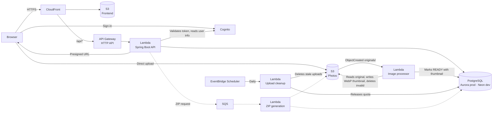

# Pictures POV App

Guests scan a QR code at an event and upload their photos, with no account needed; the organizer collects them all in one gallery.

## How it works

1. An administrator creates the event for an organizer's email; the event starts Open.
2. The organizer creates an account with that email, accepts the event and places its QR code at the venue.
3. Guests scan it and upload photos from their phone (10 per device by default).
4. Guests upload only while the event is Open and never see the photos afterwards, not even their own.
5. The organizer and their moderators review the photos and hide the ones that should not appear in the gallery.
6. The organizer downloads every photo as a ZIP.

## Roles

| Role | Who | Can |
|---|---|---|
| Guest | Event attendee, no account | Upload photos |
| Organizer | User with the event's OWNER invitation | Customize the event, invite moderators, moderate and download photos |
| Moderator | User invited by the organizer | View the gallery and review, hide and show photos |
| Administrator | Platform team | Manage all events and users |

## Scope

**Included:** QR access without registration · uploads with per-device and per-event limits · gallery and review for the organizer and moderators · account creation and sign-in with email · moderation · single and ZIP downloads · admin panel · thumbnails · automatic deletion after a retention period.

**Not in the first version:** videos · payments · self-service event creation · sign-in with Google · comments and reactions · gallery for guests · photo editing · facial recognition · native app.

Details: [functional requirements](docs/01_functional_requirements.md).

## Architecture

Serverless on AWS: each environment with no traffic costs ≤ 25 USD/month.



| Part | Technology | ADR |
|---|---|---|
| Frontend | React + Vite + TypeScript, npm, on S3 + CloudFront; CloudFront also routes `/api/*` to the API | [0002](docs/adr/0002-npm-without-workspaces.md), [0003](docs/adr/0003-frontend-react.md), [0017](docs/adr/0017-api-same-origin-cloudfront.md) |
| Backend | Spring Boot 4.1.1 + Java 21, Maven, on Lambda as a zip with SnapStart and Lambda Web Adapter | [0001](docs/adr/0001-backend-spring-boot-en-lambda.md), [0013](docs/adr/0013-lambda-zip-snapstart-web-adapter.md), [0005](docs/adr/0005-compute-aws-lambda.md), [0009](docs/adr/0009-backend-build-tool-maven.md) |
| Database | Aurora Serverless v2 (PostgreSQL), Liquibase in CI/CD | [0004](docs/adr/0004-database-aurora-serverless-v2.md), [0010](docs/adr/0010-database-migrations-liquibase.md) |
| Sign-in | Amazon Cognito | [0006](docs/adr/0006-authentication-amazon-cognito.md) |
| Photos | S3 with direct uploads (presigned URLs); WebP thumbnails with sharp | [0022](docs/adr/0022-thumbnails-sharp-heic-wasm.md) |
| ZIP | Background Lambda via SQS | [0008](docs/adr/0008-background-zip-generation.md) |
| Infrastructure | Terraform, one AWS account, state in S3 | [0007](docs/adr/0007-infrastructure-as-code-terraform.md), [0011](docs/adr/0011-terraform-state-amazon-s3.md), [0012](docs/adr/0012-single-aws-account.md) |
| CI/CD | GitHub Actions with OIDC | — |

## Repository

```
apps/
  web/              Frontend (React)
  api/              Backend (Spring Boot)
  image-processor/  Lambda that validates uploaded photos and makes their thumbnails (Node.js)
  upload-cleanup/   Scheduled Lambda that frees stale uploads (Node.js)
db/                 Liquibase migrations
infra/
  bootstrap/        Bucket for the Terraform state
  modules/          Reusable Terraform modules
  environments/     dev (prod added later)
scripts/            Helper scripts
docs/               Requirements and ADRs
```

## Getting started

Needs Java 21, Node 24, Docker and the Liquibase CLI.

```bash
# 1. Database: Postgres in Docker, then the migrations
docker run -d --name pov-db -p 5432:5432 \
  -e POSTGRES_DB=picturepov -e POSTGRES_USER=app -e POSTGRES_PASSWORD=app postgres:17-alpine
./scripts/liquibase-db.sh update

# 2. API on http://localhost:8080/api (the local profile signs in against the dev Cognito)
cd apps/api && ./mvnw spring-boot:run

# 3. Web on http://localhost:5173; Vite proxies /api to the API
cd apps/web && cp .env.example .env && npm ci && npm run dev
```

| Task | Command |
|---|---|
| API tests (throwaway Postgres) | `./scripts/api-test.sh` |
| Web checks | `cd apps/web && npm run lint && npm test && npm run build` |
| Refresh the OpenAPI contract and web types | `./scripts/openapi-export.sh` |

Fill `apps/web/.env` from `terraform output` in `infra/environments/dev/app`. Uploads need `PHOTOS_BUCKET` set for the API.

### Photo Lambdas against the local database

Local uploads land in the dev bucket, but the dev Lambdas use the dev database, so local rows stay `PENDING`. After uploading, run `npm run local` by hand:

| App | Does |
|---|---|
| [image-processor](apps/image-processor/README.md#local-run) | Validates the local `PENDING` photos already in the bucket |
| [upload-cleanup](apps/upload-cleanup/README.md#local-run) | Releases local uploads abandoned for more than twice P-10 |

### First administrator

After the first `terraform apply` of an environment, create its first admin:

```bash
./scripts/create-first-admin.sh <user-pool-id> <email>
```

## Documentation

- [Functional requirements](docs/01_functional_requirements.md)
- [Non-functional requirements](docs/02_non_functional_requirements.md)
- [Glossary](GLOSSARY.md)
- [Architecture decisions (ADR)](docs/adr/README.md)
