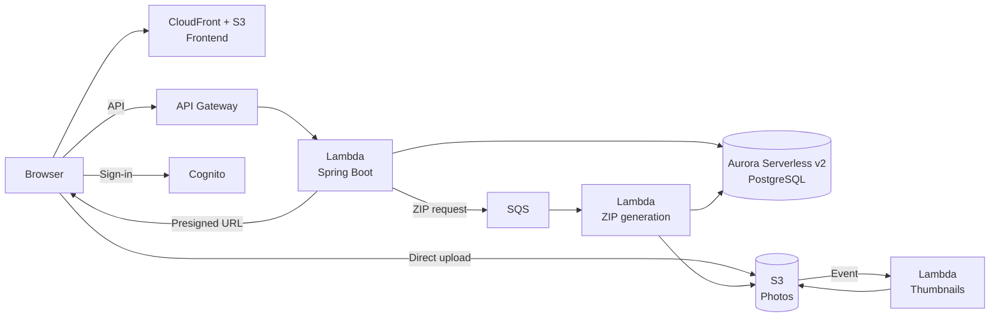

# Pictures POV App

Guests scan a QR code at an event and upload their photos to a shared gallery, with no account needed.

## How it works

1. An administrator creates the event and assigns it to an organizer.
2. The organizer places the event's QR code at the venue.
3. Guests scan it and upload photos from their phone (10 per device by default).
4. Everyone sees the photos in the event gallery.
5. The organizer moderates the photos and downloads them as a ZIP.

## Roles

| Role | Who | Can |
|---|---|---|
| Guest | Event attendee, no account | Upload photos, view the gallery |
| Organizer | Customer with assigned events | Customize the event, moderate and download photos |
| Administrator | Platform team | Manage all events and users |

## Scope

**Included:** QR access without registration · uploads with per-device and per-event limits · gallery that is public, PIN-protected or organizer-only · sign-in with Google or email · moderation · single and ZIP downloads · admin panel · thumbnails · automatic deletion after a retention period.

**Not in the first version:** videos · payments · self-service sign-up · comments and reactions · photo editing · facial recognition · native app.

Details: [functional requirements](docs/01_requisitos_funcionales.md).

## Architecture

Serverless on AWS: each environment with no traffic costs ≤ 25 USD/month.



| Part | Technology | ADR |
|---|---|---|
| Frontend | React + Vite + TypeScript, npm, on S3 + CloudFront | [0002](docs/adr/0002-npm-without-workspaces.md), [0003](docs/adr/0003-frontend-react.md) |
| Backend | Spring Boot 4.1.1 + Java 21, Maven, on Lambda as a zip with SnapStart and Lambda Web Adapter | [0001](docs/adr/0001-backend-spring-boot-en-lambda.md), [0014](docs/adr/0014-lambda-zip-snapstart-web-adapter.md), [0005](docs/adr/0005-compute-aws-lambda.md), [0009](docs/adr/0009-backend-build-tool-maven.md) |
| Database | Aurora Serverless v2 (PostgreSQL), Liquibase in CI/CD | [0004](docs/adr/0004-database-aurora-serverless-v2.md), [0010](docs/adr/0010-database-migrations-liquibase.md) |
| Sign-in | Amazon Cognito | [0006](docs/adr/0006-authentication-amazon-cognito.md) |
| Photos | S3 with direct uploads (presigned URLs) and WebP thumbnails | — |
| ZIP | Background Lambda via SQS | [0008](docs/adr/0008-background-zip-generation.md) |
| Infrastructure | Terraform, one AWS account, state in S3 | [0007](docs/adr/0007-infrastructure-as-code-terraform.md), [0011](docs/adr/0011-terraform-state-amazon-s3.md), [0012](docs/adr/0012-single-aws-account.md) |
| CI/CD | GitHub Actions with OIDC | — |

## Repository

```
apps/
  web/            Frontend (React)
  api/            Backend (Spring Boot)
infra/
  bootstrap/      Bucket for the Terraform state
  modules/        Reusable Terraform modules
  environments/   dev and prod
docs/             Requirements and ADRs
```

## Getting started

Pending: documented after phase 1.

## Documentation

- [Functional requirements](docs/01_requisitos_funcionales.md)
- [Non-functional requirements](docs/02_requisitos_no_funcionales.md)
- [Architecture decisions (ADR)](docs/adr/README.md)
